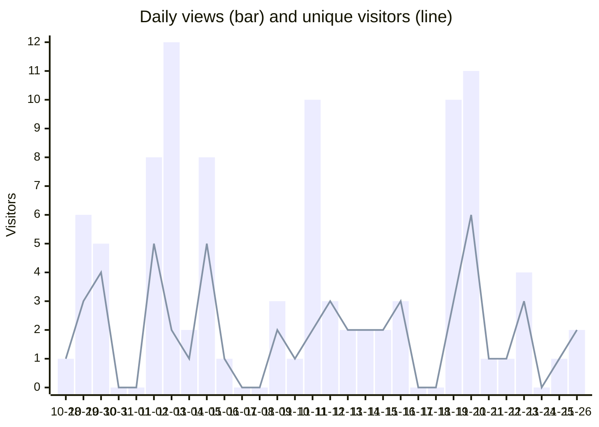
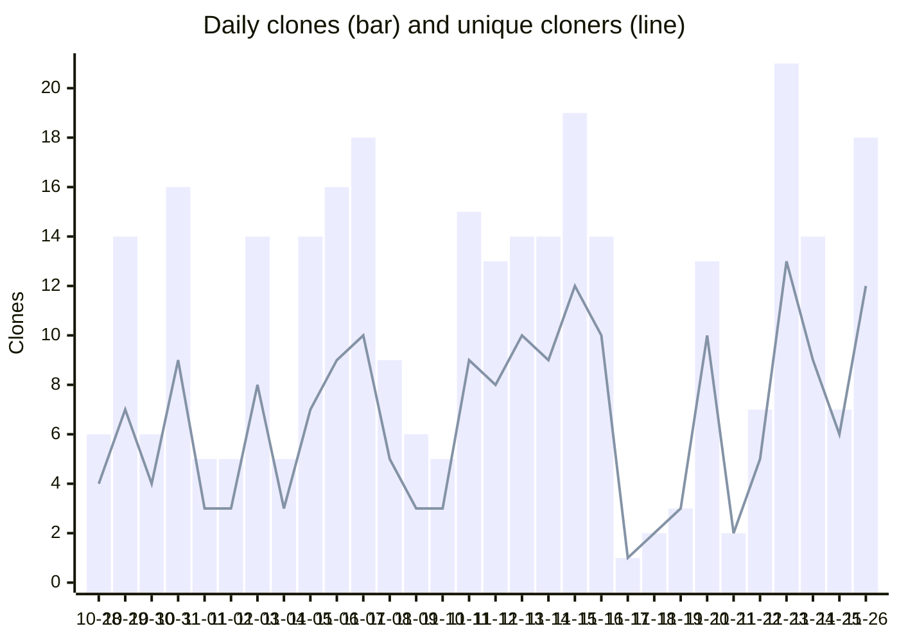

# Toolkit Usage Dashboard

_Auto-generated 2026-11-27 by the Traffic snapshot workflow. History: 2026-09-21 to 2026-11-26._

> **How to read this:** _Clones_ are downloads that run the toolkit (each is a git checkout). _Views_ are page visits. GitHub Traffic is anonymous, so these are counts only, never usernames. A few clones each day come from this repo's own automation, not people.

## At a glance

| Metric | Views | Clones |
|---|---:|---:|
| Total (all history) | 406 | 705 |
| Last 7 days | 20 | 82 |
| Daily average | 6.1 | 10.5 |
| Busiest day | 2026-09-24 (91) | 2026-10-11 (39) |

## Daily views

## Daily clones

## Recent activity (last 14 days)

| Date | Views | Unique visitors | Clones | Unique cloners |
|---|---:|---:|---:|---:|
| 2026-11-13 | 2 | 2 | 14 | 10 |
| 2026-11-14 | 2 | 2 | 14 | 9 |
| 2026-11-15 | 2 | 2 | 19 | 12 |
| 2026-11-16 | 3 | 3 | 14 | 10 |
| 2026-11-17 | 0 | 0 | 1 | 1 |
| 2026-11-18 | 0 | 0 | 2 | 2 |
| 2026-11-19 | 10 | 3 | 3 | 3 |
| 2026-11-20 | 11 | 6 | 13 | 10 |
| 2026-11-21 | 1 | 1 | 2 | 2 |
| 2026-11-22 | 1 | 1 | 7 | 5 |
| 2026-11-23 | 4 | 3 | 21 | 13 |
| 2026-11-24 | 0 | 0 | 14 | 9 |
| 2026-11-25 | 1 | 1 | 7 | 6 |
| 2026-11-26 | 2 | 2 | 18 | 12 |

---
_Source: GitHub repository Traffic API. Raw history lives in `metrics/traffic-views.csv` and `metrics/traffic-clones.csv`._
