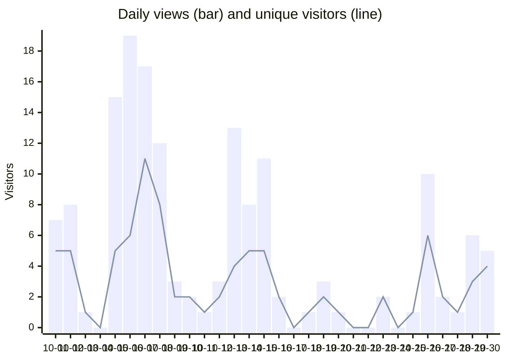
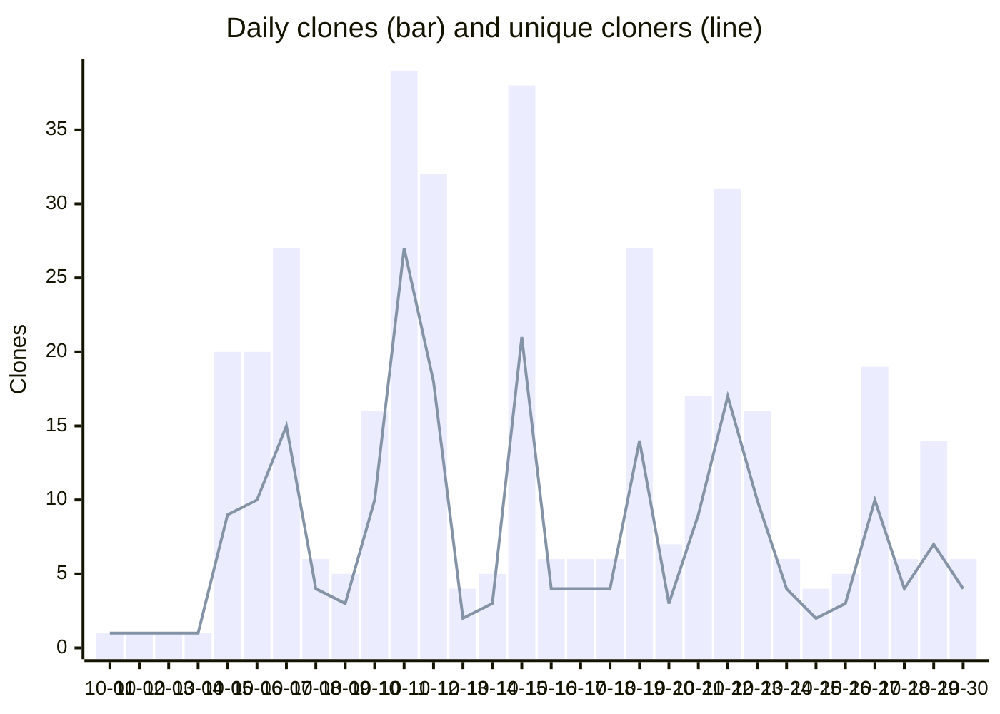

# Toolkit Usage Dashboard

_Auto-generated 2026-10-31 by the Traffic snapshot workflow. History: 2026-09-21 to 2026-10-30._

> **How to read this:** _Clones_ are downloads that run the toolkit (each is a git checkout). _Views_ are page visits. GitHub Traffic is anonymous, so these are counts only, never usernames. A few clones each day come from this repo's own automation, not people.

## At a glance

| Metric | Views | Clones |
|---|---:|---:|
| Total (all history) | 319 | 415 |
| Last 7 days | 25 | 60 |
| Daily average | 8.0 | 10.4 |
| Busiest day | 2026-09-24 (91) | 2026-10-11 (39) |

## Daily views

## Daily clones

## Recent activity (last 14 days)

| Date | Views | Unique visitors | Clones | Unique cloners |
|---|---:|---:|---:|---:|
| 2026-10-17 | 0 | 0 | 6 | 4 |
| 2026-10-18 | 1 | 1 | 6 | 4 |
| 2026-10-19 | 3 | 2 | 27 | 14 |
| 2026-10-20 | 1 | 1 | 7 | 3 |
| 2026-10-21 | 0 | 0 | 17 | 9 |
| 2026-10-22 | 0 | 0 | 31 | 17 |
| 2026-10-23 | 2 | 2 | 16 | 10 |
| 2026-10-24 | 0 | 0 | 6 | 4 |
| 2026-10-25 | 1 | 1 | 4 | 2 |
| 2026-10-26 | 10 | 6 | 5 | 3 |
| 2026-10-27 | 2 | 2 | 19 | 10 |
| 2026-10-28 | 1 | 1 | 6 | 4 |
| 2026-10-29 | 6 | 3 | 14 | 7 |
| 2026-10-30 | 5 | 4 | 6 | 4 |

---
_Source: GitHub repository Traffic API. Raw history lives in `metrics/traffic-views.csv` and `metrics/traffic-clones.csv`._
