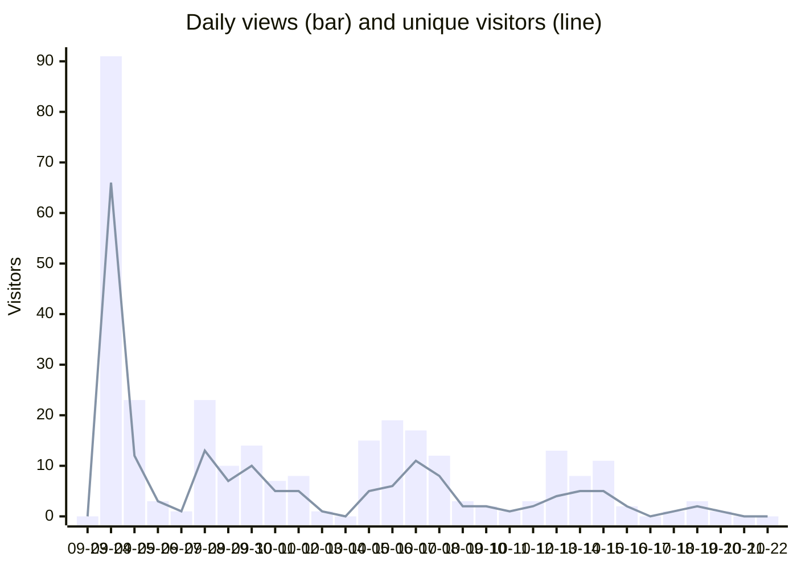
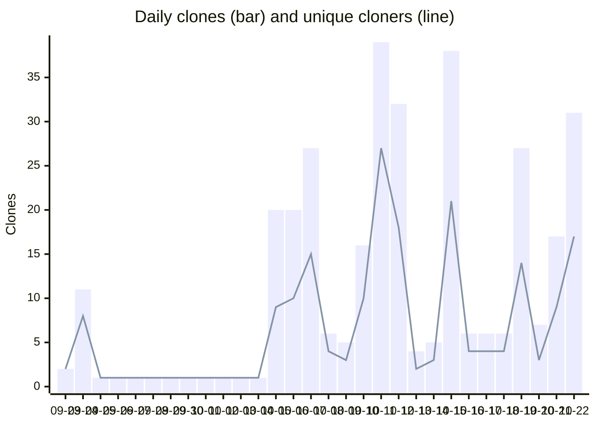

# Toolkit Usage Dashboard

_Auto-generated 2026-10-23 by the Traffic snapshot workflow. History: 2026-09-21 to 2026-10-22._

> **How to read this:** _Clones_ are downloads that run the toolkit (each is a git checkout). _Views_ are page visits. GitHub Traffic is anonymous, so these are counts only, never usernames. A few clones each day come from this repo's own automation, not people.

## At a glance

| Metric | Views | Clones |
|---|---:|---:|
| Total (all history) | 292 | 339 |
| Last 7 days | 7 | 100 |
| Daily average | 9.1 | 10.6 |
| Busiest day | 2026-09-24 (91) | 2026-10-11 (39) |

## Daily views

## Daily clones

## Recent activity (last 14 days)

| Date | Views | Unique visitors | Clones | Unique cloners |
|---|---:|---:|---:|---:|
| 2026-10-09 | 3 | 2 | 5 | 3 |
| 2026-10-10 | 2 | 2 | 16 | 10 |
| 2026-10-11 | 1 | 1 | 39 | 27 |
| 2026-10-12 | 3 | 2 | 32 | 18 |
| 2026-10-13 | 13 | 4 | 4 | 2 |
| 2026-10-14 | 8 | 5 | 5 | 3 |
| 2026-10-15 | 11 | 5 | 38 | 21 |
| 2026-10-16 | 2 | 2 | 6 | 4 |
| 2026-10-17 | 0 | 0 | 6 | 4 |
| 2026-10-18 | 1 | 1 | 6 | 4 |
| 2026-10-19 | 3 | 2 | 27 | 14 |
| 2026-10-20 | 1 | 1 | 7 | 3 |
| 2026-10-21 | 0 | 0 | 17 | 9 |
| 2026-10-22 | 0 | 0 | 31 | 17 |

---
_Source: GitHub repository Traffic API. Raw history lives in `metrics/traffic-views.csv` and `metrics/traffic-clones.csv`._
